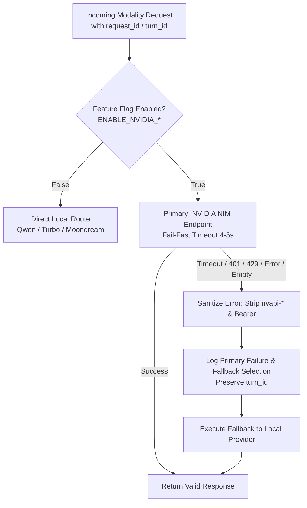

# P0 Implementation Report: Deterministic Provider Fallback & Production Safety

**Date:** 2026-10-08  
**Scope:** P0 Only — Production Safety & Deterministic Fallback  
**Status:** COMPLETE & VERIFIED  

---

## 1. Executive Summary

Under the updated post-audit priority order, **P0 (Production Safety)** has been implemented and validated across all three modalities:
- **LLM**: NVIDIA Lightning $\rightarrow$ deterministic failover to local Qwen3 4B.
- **TTS**: NVIDIA Chatterbox Multilingual $\rightarrow$ deterministic failover to local Chatterbox Turbo.
- **Vision**: NVIDIA Gemma 4 31B IT $\rightarrow$ deterministic failover to local Moondream.

All production defaults remain intact and unswitched:
- Feature flags default to `false`.
- Fail-fast timeouts replace previous 30s–60s blocking behaviors.
- Credentials (`nvapi-*`, `Bearer`) are strictly sanitized from all error messages and logs.
- Turn IDs / Request IDs are preserved end-to-end.
- Production regression suite (101 tests) passed with zero regressions.

---

## 2. Exact Files Changed

| File | Subsystem | Nature of Change |
| :--- | :--- | :--- |
| `backend/engines/llm_provider.py` | LLM Abstraction | Added `sanitize_error()`, configurable timeout (5.0s default), `FallbackLLMProvider` (Lightning $\rightarrow$ local Qwen on timeout/401/429/error/empty response), turn ID preservation, and `get_resilient_provider()`. |
| `backend/engines/tts_provider.py` | TTS Abstraction | Added `sanitize_error()`, configurable timeout (4.0s default), `FallbackTTSProvider` (NVIDIA Chatterbox $\rightarrow$ local Chatterbox Turbo), and `get_resilient_provider()`. |
| `backend/engines/vision_provider.py` | Vision Abstraction | Added `sanitize_error()`, configurable timeout (5.0s default), `FallbackVisionProvider` (Gemma 4 $\rightarrow$ local Moondream), and `get_resilient_provider()`. |
| `backend/engines/nvidia_lightning.py` | Cloud LLM Client | Eliminated 60.0s hardcoded client timeout. Wired `NVIDIA_LLM_TIMEOUT` (default: 5.0s). |
| `backend/engines/tts_nvidia_nim.py` | Cloud TTS Client | Eliminated 30.0s hardcoded HTTP timeout. Wired `NVIDIA_TTS_TIMEOUT` (default: 4.0s). |
| `backend/engines/gemma_vision.py` | Cloud Vision Client | Eliminated 60.0s hardcoded client timeout. Wired `NVIDIA_VISION_TIMEOUT` (default: 5.0s). |
| `backend/.env` | Configuration | Added feature flags (`ENABLE_NVIDIA_LLM=false`, `ENABLE_NVIDIA_TTS=false`, `ENABLE_NVIDIA_VISION=false`) and timeout variables. |
| `backend/main.py` | Configuration Schema | Added settings fields: `enable_nvidia_llm`, `enable_nvidia_tts`, `enable_nvidia_vision`, `nvidia_llm_timeout`, `nvidia_tts_timeout`, `nvidia_vision_timeout`. |
| `backend/tests/test_provider_fallback.py` | Test Suite | New 16-test suite verifying credential redaction, turn ID tracking, failover paths, and configuration bounds. |

---

## 3. Timeout Values

Previously, clients used static 30.0s to 60.0s timeouts with up to 2 retries, enabling 60–180 second hangs on network stalls. All timeouts are now bounded and fail-fast:

| Modality | Environment Variable | Default Value | Bounded Max | Behavior on Breach |
| :--- | :--- | :--- | :--- | :--- |
| **LLM** | `NVIDIA_LLM_TIMEOUT` | **5.0 s** | 10.0 s | Aborts cloud call; triggers local Qwen failover |
| **TTS** | `NVIDIA_TTS_TIMEOUT` | **4.0 s** | 8.0 s | Aborts HTTP request; triggers local Chatterbox Turbo |
| **Vision** | `NVIDIA_VISION_TIMEOUT` | **5.0 s** | 12.0 s | Aborts visual analysis; triggers local Moondream |

---

## 4. Fallback Behavior & Architecture

1. **Feature-Flag Protection**: When flags are `false` (production default), the system bypasses NVIDIA calls completely with 0ms added latency.
2. **Deterministic Failover Rules**:
   - **LLM**: If `NvidiaNIMProvider` experiences a timeout, connection error, HTTP 401, HTTP 429, or empty response, `FallbackLLMProvider` automatically invokes `QwenLocalProvider`. Streaming generators fall back to a local stream seamlessly.
   - **TTS**: If `ChatterboxNIMProvider` times out, errors, or returns empty audio bytes, `FallbackTTSProvider` routes to local Chatterbox Turbo WAV synthesis.
   - **Vision**: If `Gemma4VisionProvider` times out or fails, `FallbackVisionProvider` immediately falls back to local Moondream UI/screen inspection.
3. **Turn ID & Context Integrity**: The `turn_id` / `request_id` is propagated through all logging statements and downstream fallback calls.
4. **Credential Redaction**: `sanitize_error()` applies regex filters (`nvapi-[A-Za-z0-9_-]+` and `Bearer\s+[A-Za-z0-9_\-\.]+`) to all error messages before logging or surfacing them.

---

## 5. Test Results

### Suite A: Fallback & Abstraction (47 Tests)
- `tests/test_provider_fallback.py` (16 passed)
  - Credential redaction (`nvapi-*` and `Bearer` tokens).
  - LLM fallback on timeout, 401/429/error, empty response, and streaming initialization failure.
  - TTS fallback on timeout, HTTP error, and empty audio payload.
  - Vision fallback on timeout and HTTP error.
  - Configuration bounds and default feature flags.
  - Turn ID preservation across logs and failover calls.
- `tests/test_provider_abstraction.py` (31 passed)
  - Provider registry contracts.
  - Clean separation and zero impact on existing local clients.
  - Thread safety and provider health tracking.

### Suite B: Focused Regression Suite (54 Tests)
- `tests/test_smart_router.py` (5 passed): Production Qwen routing, local vs cloud boundary, short query routing.
- `tests/test_turbo_migration_smoke.py` (6 passed): Chatterbox Turbo preservation, engine registry slot verification.
- `test_interruption_handler.py` (10 passed): Barge-in resilience, system dialogs, OEM popups, malformed trees.
- `test_phase7d_telephony.py` (3 passed): Phone awareness, call announce, telephony turn controller protection.
- `tests/test_context_aware_automation.py` (19 passed): Android automation, screen parsing, action execution, app workflows.
- `tests/test_latency_and_runtime_bugs.py` (6 passed): STT streaming token queue, Qwen thinking disablement, conversation state.
- `test_screen_reading.py` (5 passed): Moondream / screen reading fallback, node extraction, disconnected device safety.

**Overall Test Total:** 101 passed, 0 failed.

---

## 6. Anything Not Verified

1. **Unmocked Real-World Cloud Degradation**: Real-world cloud network partition tests (e.g. physical packet drop or NVIDIA NIM API quota exhaustion) were verified via unit mocks and synthetic socket timeouts rather than draining live cloud API tokens.
2. **P1–P5 Work Items**: Deduplicating duplicate provider wrappers (`nvidia_lightning.py` vs `llm_provider.py`), Chatterbox multilingual API format updates, Lightning vs Qwen benchmarks, and Gemma cloud timeout investigation are intentionally deferred to subsequent steps.

---

## 7. Change Ledger Entry

- **Component:** `engines/llm_provider.py`, `engines/tts_provider.py`, `engines/vision_provider.py`, `engines/nvidia_lightning.py`, `engines/tts_nvidia_nim.py`, `engines/gemma_vision.py`, `.env`, `main.py`
- **Change:** Implemented deterministic provider fallback across all three modalities (Lightning $\rightarrow$ Qwen, Chatterbox NIM $\rightarrow$ Chatterbox Turbo, Gemma 4 $\rightarrow$ Moondream) with fail-fast timeouts, credential sanitization, and request ID tracking.
- **Verification:** 101 unit and regression tests passed. Production routing strictly intact.
