# P1 — NVIDIA-FIRST PROVIDER ARCHITECTURE REFACTOR REPORT

**Status:** COMPLETE & VERIFIED  
**Phase:** P1  
**Date:** October 8, 2026  
**Test Battery:** 112 / 112 passed (100%)  

---

## 1. Executive Summary

In accordance with architectural directive **P1**, the MJ/ALITA assistant's core pipeline has been decoupled from concrete legacy local engines (`ollama_client.py`, `tts_chatterbox_turbo.py`, and `vision_engine.py`). 

A contract-first provider architecture has been established with:
1. **Formal Contracts & 3-State Health Model**: `LLMProviderContract`, `TTSProviderContract`, and `VisionProviderContract` in `engines/provider_contracts.py` with states `AVAILABLE`, `DEGRADED`, and `UNAVAILABLE`.
2. **Centralized Provider Orchestration Layer**: `engines/provider_orchestrator.py` is the single authority for primary/fallback configuration, alias normalization, readiness gating (preventing unflagged or unkeyed models from activating blindly), fail-fast timeouts, credential sanitization (`nvapi-*`, `Bearer`), and removal simulation resilience.
3. **Primary/Fallback Configuration**: Default intended production configuration is NVIDIA-first (`LLM_PRIMARY=nemotron_lightning`, `TTS_PRIMARY=chatterbox_multilingual`, `VISION_PRIMARY=gemma4`) with local fallbacks (`LLM_FALLBACK=qwen_local`, `TTS_FALLBACK=chatterbox_turbo`, `VISION_FALLBACK=moondream`).
4. **Complete Core Pipeline Decoupling**: Direct imports of legacy engines across all 12 core MJ modules have been removed. Core modules now communicate strictly with provider contracts or via `get_provider_orchestrator()`.
5. **Zero Production Drift & Zero Regression**: All existing 101 tests plus 11 new P1 architecture tests pass (112 total). Production behavior remains safe and deterministic when NVIDIA feature flags are disabled.

---

## 2. Exact Files Modified & Created

### A. New Architecture Modules
- [`backend/engines/provider_contracts.py`](file:///c:/Users/sarwa/Desktop/aura-assistant/backend/engines/provider_contracts.py): Base abstract contracts and 3-state health tracking (`ProviderStatus.AVAILABLE`, `ProviderStatus.DEGRADED`, `ProviderStatus.UNAVAILABLE`).
- [`backend/engines/provider_orchestrator.py`](file:///c:/Users/sarwa/Desktop/aura-assistant/backend/engines/provider_orchestrator.py): Unified orchestration singleton managing primary/fallback selection, health checks, credential stripping, and removal resilience.
- [`backend/tests/test_provider_architecture_p1.py`](file:///c:/Users/sarwa/Desktop/aura-assistant/backend/tests/test_provider_architecture_p1.py): AST static audit, readiness state transitions, configuration resolution, removal simulation, and modular registration test suite.

### B. Updated Provider Modules
- [`backend/engines/llm_provider.py`](file:///c:/Users/sarwa/Desktop/aura-assistant/backend/engines/llm_provider.py): Inherits `LLMProviderContract`; wraps `QwenLocalProvider` and `NvidiaNIMProvider`; supports `unregister()`.
- [`backend/engines/tts_provider.py`](file:///c:/Users/sarwa/Desktop/aura-assistant/backend/engines/tts_provider.py): Inherits `TTSProviderContract`; wraps `ChatterboxLocalProvider` and `ChatterboxNIMProvider`; supports `unregister()`.
- [`backend/engines/vision_provider.py`](file:///c:/Users/sarwa/Desktop/aura-assistant/backend/engines/vision_provider.py): Inherits `VisionProviderContract`; wraps `MoondreamLocalProvider` and `GemmaVisionProvider`; supports `unregister()`.

### C. Decoupled Core MJ Pipeline Files (12 files)
1. [`backend/main.py`](file:///c:/Users/sarwa/Desktop/aura-assistant/backend/main.py): Added P1 Settings (`llm_primary`, `llm_fallback`, `tts_primary`, `tts_fallback`, `vision_primary`, `vision_fallback`); startup health checks and engine retrieval route via orchestrator; tool orchestrator routes via orchestrator.
2. [`backend/tts_dispatch.py`](file:///c:/Users/sarwa/Desktop/aura-assistant/backend/tts_dispatch.py): `get_or_load_turbo_engine()` resolves engine through orchestrator (`orch.get_tts_engine()`) rather than importing `tts_chatterbox_turbo`.
3. [`backend/threads/general_handler.py`](file:///c:/Users/sarwa/Desktop/aura-assistant/backend/threads/general_handler.py): `_try_ollama` and `_try_ollama_stream` route chat calls through orchestrator; barge-in cancellation and `<think>` suppression preserved.
4. [`backend/threads/realtime_handler.py`](file:///c:/Users/sarwa/Desktop/aura-assistant/backend/threads/realtime_handler.py): System prompt and time formatting chat call routes via orchestrator.
5. [`backend/threads/automation_handler.py`](file:///c:/Users/sarwa/Desktop/aura-assistant/backend/threads/automation_handler.py): All 5 `ollama_chat` call sites routed via orchestrator.
6. [`backend/engines/screen_agent.py`](file:///c:/Users/sarwa/Desktop/aura-assistant/backend/engines/screen_agent.py): Text reasoning and vision coordinate localization routed via orchestrator.
7. [`backend/engines/browser_controller.py`](file:///c:/Users/sarwa/Desktop/aura-assistant/backend/engines/browser_controller.py): Vision screen analysis routed via orchestrator.
8. [`backend/routers/system_router.py`](file:///c:/Users/sarwa/Desktop/aura-assistant/backend/routers/system_router.py): `system_info` and `local_vision` route through orchestrator.
9. [`backend/routers/geospatial.py`](file:///c:/Users/sarwa/Desktop/aura-assistant/backend/routers/geospatial.py): Geospatial intel briefing routes via orchestrator.
10. [`backend/engines/workflows/blog_publisher.py`](file:///c:/Users/sarwa/Desktop/aura-assistant/backend/engines/workflows/blog_publisher.py): Blog generation routes via orchestrator.
11. [`backend/engines/workflows/youtube_shorts.py`](file:///c:/Users/sarwa/Desktop/aura-assistant/backend/engines/workflows/youtube_shorts.py): Shorts script generation routes via orchestrator.
12. [`backend/engines/shadow_benchmark.py`](file:///c:/Users/sarwa/Desktop/aura-assistant/backend/engines/shadow_benchmark.py): Qwen comparison routes via `llm_registry.get("qwen_local")`.

### D. Configuration & Test Fixture Files
- [`backend/.env`](file:///c:/Users/sarwa/Desktop/aura-assistant/backend/.env): Added `LLM_PRIMARY`, `LLM_FALLBACK`, `TTS_PRIMARY`, `TTS_FALLBACK`, `VISION_PRIMARY`, `VISION_FALLBACK`.
- [`backend/test_phase7d_telephony.py`](file:///c:/Users/sarwa/Desktop/aura-assistant/backend/test_phase7d_telephony.py): Cleaned up global `sys.modules["tts_dispatch"]` mock pollution to preserve real module testing across multi-file test suites.

---

## 3. Direct Legacy Imports Removed

The following direct concrete imports were eliminated from all core pipeline files:

| Core Pipeline File | Prior Concrete Legacy Import | Decoupled Replacement |
|---|---|---|
| `backend/main.py` | `from engines.ollama_client import check_ollama_health` | `get_provider_orchestrator().is_llm_ready()` |
| `backend/tts_dispatch.py` | `from engines.tts_chatterbox_turbo import get_chatterbox_turbo_engine` | `get_provider_orchestrator().get_tts_engine()` |
| `backend/threads/general_handler.py` | `from engines.ollama_client import ollama_chat, ollama_chat_stream` | `get_provider_orchestrator().chat(...)`, `.chat_stream(...)` |
| `backend/threads/realtime_handler.py` | `from engines.ollama_client import ollama_chat` | `get_provider_orchestrator().chat(...)` |
| `backend/threads/automation_handler.py` | `from engines.ollama_client import ollama_chat` | `get_provider_orchestrator().chat(...)` |
| `backend/engines/screen_agent.py` | `from engines.ollama_client import ollama_chat` | `get_provider_orchestrator().chat(...)` |
| `backend/engines/screen_agent.py` | `from engines.vision_engine import moondream_engine` | `get_provider_orchestrator().locate_element(...)` |
| `backend/engines/browser_controller.py` | `from engines.vision_engine import moondream_engine` | `get_provider_orchestrator().analyze_vision(...)` |
| `backend/routers/system_router.py` | `from engines.vision_engine import moondream_engine` | `get_provider_orchestrator().analyze_vision(...)` |
| `backend/routers/geospatial.py` | `from engines.ollama_client import ollama_chat` | `get_provider_orchestrator().chat(...)` |
| `backend/engines/workflows/blog_publisher.py` | `from engines.ollama_client import ollama_chat` | `get_provider_orchestrator().chat(...)` |
| `backend/engines/workflows/youtube_shorts.py` | `from engines.ollama_client import ollama_chat` | `get_provider_orchestrator().chat(...)` |
| `backend/engines/shadow_benchmark.py` | `from engines.ollama_client import ollama_chat` | `llm_registry.get("qwen_local").chat(...)` |

**Verification**: Automated AST analysis in [`tests/test_provider_architecture_p1.py`](file:///c:/Users/sarwa/Desktop/aura-assistant/backend/tests/test_provider_architecture_p1.py) parses every AST `Import` and `ImportFrom` node across all 12 core files and validates that **0** direct imports of `ollama_client`, `tts_chatterbox_turbo`, or `vision_engine` exist. Concrete engines are imported only inside their respective adapter files (`llm_provider.py`, `tts_provider.py`, `vision_provider.py`).

---

## 4. Provider Dependency Graph

```mermaid
graph TD
    subgraph "Core MJ Pipeline (No Direct Legacy Imports)"
        MAIN["main.py"]
        GEN["threads/general_handler.py"]
        RT["threads/realtime_handler.py"]
        AUTO["threads/automation_handler.py"]
        TTSD["tts_dispatch.py"]
        SCR["engines/screen_agent.py"]
        BROWSE["engines/browser_controller.py"]
        ROUT["routers/system_router.py & geospatial.py"]
        WF["workflows/*.py"]
    end

    subgraph "Provider Contracts & Orchestration Layer"
        CONTRACTS["engines/provider_contracts.py<br/>(LLM/TTS/Vision Contracts, ProviderStatus)"]
        ORCH["engines/provider_orchestrator.py<br/>(ProviderOrchestrator)"]
    end

    subgraph "Registries & Adapters"
        LLM_REG["engines/llm_provider.py<br/>(llm_registry)"]
        TTS_REG["engines/tts_provider.py<br/>(tts_registry)"]
        VIS_REG["engines/vision_provider.py<br/>(vision_registry)"]
    end

    subgraph "Primary Providers (NVIDIA NIM - Primary Targets)"
        NIM_LIGHTNING["NvidiaNIMProvider<br/>(Nemotron-3.5-Lightning-30B-A3B)"]
        NIM_TTS["ChatterboxNIMProvider<br/>(Chatterbox Multilingual NIM)"]
        NIM_GEMMA["GemmaVisionProvider<br/>(Gemma 4 31B IT)"]
    end

    subgraph "Fallback Providers (Removable Legacy Adapters)"
        QWEN_LOC["QwenLocalProvider"]
        TURBO_LOC["ChatterboxLocalProvider"]
        MOON_LOC["MoondreamLocalProvider"]
    end

    subgraph "Concrete Legacy Engines"
        OLLAMA["engines/ollama_client.py"]
        TURBO["engines/tts_chatterbox_turbo.py"]
        MOONDREAM["engines/vision_engine.py"]
    end

    MAIN --> ORCH
    GEN --> ORCH
    RT --> ORCH
    AUTO --> ORCH
    TTSD --> ORCH
    SCR --> ORCH
    BROWSE --> ORCH
    ROUT --> ORCH
    WF --> ORCH

    ORCH --> CONTRACTS
    ORCH --> LLM_REG
    ORCH --> TTS_REG
    ORCH --> VIS_REG

    LLM_REG -.->|Primary| NIM_LIGHTNING
    LLM_REG -.->|Fallback| QWEN_LOC
    TTS_REG -.->|Primary| NIM_TTS
    TTS_REG -.->|Fallback| TURBO_LOC
    VIS_REG -.->|Primary| NIM_GEMMA
    VIS_REG -.->|Fallback| MOON_LOC

    QWEN_LOC --> OLLAMA
    TURBO_LOC --> TURBO
    MOON_LOC --> MOONDREAM
```



---

## 5. Test Verification Results

All 112 tests executed and passed in a single combined test battery (`64.40s`):

```
================= 112 passed, 9 warnings in 64.40s (0:01:04) ==================
```

### Breakdown of Test Suites:
1. **P1 Architecture Suite (`test_provider_architecture_p1.py`)**: 11/11 passed
   - `test_core_pipeline_files_exist`: Verified all 12 core files exist.
   - `test_no_direct_legacy_imports_in_core_pipeline`: AST static audit confirmed 0 legacy imports in core.
   - `test_broken_provider_not_activated_blindly`: Verified readiness gates unflagged/broken providers.
   - `test_provider_health_transitions`: Tested `AVAILABLE` $\rightarrow$ `DEGRADED` $\rightarrow$ `UNAVAILABLE`.
   - `test_status_enum_values`: Verified `ProviderStatus` enum definitions.
   - `test_alias_resolution`: Tested canonical mapping (`turbo`, `moondream`, `gemma4`, etc.).
   - `test_default_intended_configuration`: Verified default intended P1 configuration.
   - `test_environment_override_routing`: Verified runtime environment overrides.
   - `test_tts_unregistered_fallback_handled_gracefully`: Verified removal simulation for TTS fallback.
   - `test_unregistered_fallback_provider_handled_gracefully`: Verified removal simulation for LLM fallback.
   - `test_dynamic_provider_lifecycle`: Verified registering, using, and unregistering custom providers.

2. **Provider Fallback & Sanitization (`test_provider_fallback.py`)**: 16/16 passed
3. **Provider Abstraction (`test_provider_abstraction.py`)**: 31/31 passed
4. **Smart Query Router (`test_smart_router.py`)**: 5/5 passed
5. **Turbo Migration Smoke (`test_turbo_migration_smoke.py`)**: 6/6 passed
6. **Interruption & Dialog Dismissal (`test_interruption_handler.py`)**: 10/10 passed
7. **Telephony Awareness (`test_phase7d_telephony.py`)**: 3/3 passed
8. **Context-Aware Automation & Action Executor (`test_context_aware_automation.py`)**: 16/16 passed
9. **Latency, Thinking Suppression & Memory Bugs (`test_latency_and_runtime_bugs.py`)**: 6/6 passed
10. **Screen Reading & Node Extraction (`test_screen_reading.py`)**: 5/5 passed

---

## 6. Remaining Hard Dependencies

- **In MJ Core Pipeline**: **0**. There are zero direct dependencies on `ollama_client.py`, `tts_chatterbox_turbo.py`, or `vision_engine.py`.
- **In Adapters**: `engines/llm_provider.py`, `engines/tts_provider.py`, and `engines/vision_provider.py` hold the remaining references to the concrete legacy engines. When the legacy engines are eventually retired, deleting those 3 provider adapter classes and their corresponding configuration entries removes the legacy dependencies without touching any MJ core pipeline file.

---

## 7. Items Explicitly Not Changed / Not Verified (Out of Scope for P1)

1. **Nemotron-Super**: Explicitly omitted in accordance with P1 constraints.
2. **Chatterbox Multilingual REST/gRPC Mismatch**: Preserved as-is (scheduled for P2).
3. **Gemma 4 31B IT Cloud Timeout (>30s)**: Preserved as-is (scheduled for P4).
4. **Physical GPU VRAM Benchmarking**: Scheduled for P3 (Lightning vs Local Qwen).
